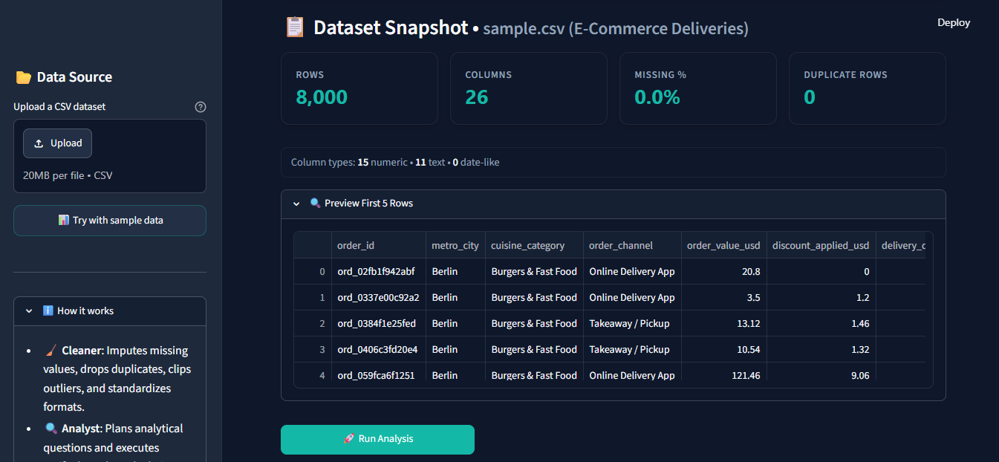
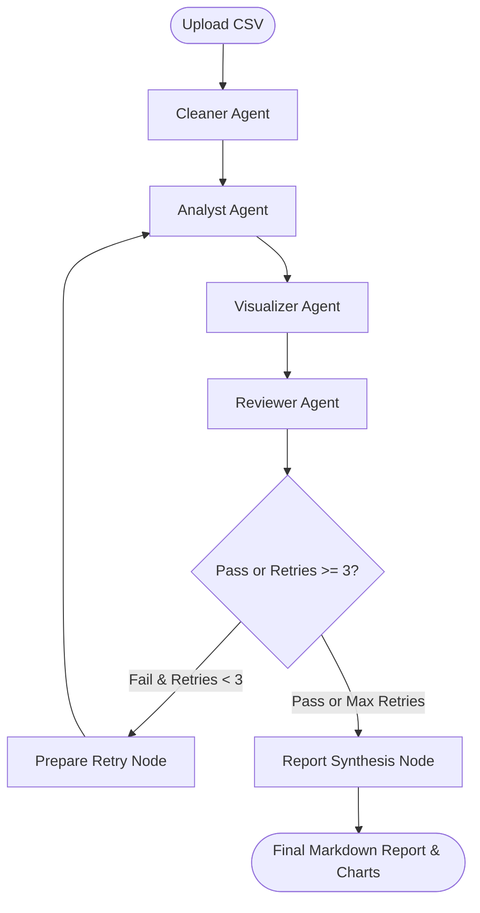

# Multi-Agent Data Analyst

[](https://github.com/samikshagla/multi-agent-data-analyst/actions/workflows/tests.yml)
[](https://multi-agent-data-analyst-a7imvrmaa5mml86xpvt9bb.streamlit.app/)

Live demo: https://multi-agent-data-analyst-a7imvrmaa5mml86xpvt9bb.streamlit.app/
- "Watch a recorded run" needs no key and makes no AI calls.
- Live runs use YOUR OWN Groq or Gemini key, kept only in your browser session's server memory and never stored.
- It runs on Streamlit Community Cloud's free tier: if the app has been idle it sleeps, click the wake-up button and wait about a minute.

*Hosted limits*: In hosted mode (`HOSTED=1`), uploads are capped at 5 MB, 30,000 rows, and 60 columns. Execution is governed by an 80,000 tokens-per-run budget, a maximum of 2 concurrent runs, a 60-second cooldown between runs per session, and a 600-second (10-minute) wall-clock time limit (see `tools/limits.py` and `DEPLOY.md`). A "Try with sample data" button lets visitors load the 8,000-row sample dataset immediately; a typical run uses about 22k tokens (up to ~58k when the reviewer triggers retries).

I built this project to analyze tabular datasets by coordinating four specialized agents. You upload a CSV, and the agents profile and clean the data, formulate business questions, write and execute pandas code, build interactive Plotly charts, and independently recheck the computed results before producing a final report.

**Tech stack**: Python, LangGraph, pandas, Plotly, Streamlit, and Groq with `openai/gpt-oss-120b` (Google Gemini is also supported via `llm.py`).

---

## Results at a Glance

- **Reviewer**: Flagged 98.8% (92.5% with a verified recompute) of 40 injected errors with a 2.5% false alarm rate on 20 correct answers.
- **Cleaner**: In the cleaner comparison, a 15-line script beat the LLM cleaner at recovering "$12.50"-style values (99.2% vs 66.2%).
- **End-to-End**: All three systems (single prompt, analyst, analyst + reviewer) scored 12/12 on 12 benchmark questions; the reviewer added 5.15x tokens and 3.42x time without changing accuracy.
- **Bug fixes**: Systematic evaluation and testing found and led me to fix five bugs across my code, harness, and UI.

---

## Screenshots

### Empty State
Initial interface when loading the application before uploading a dataset:


### Dataset Snapshot
Overview showing parsed columns, detected data types, row counts, and sample records:



### Reviewer Findings
Audit view showing side-by-side recomputations (Analyst Result vs Reviewer Recomputed) and verification status:


---

## How It Works

The workflow is orchestrated using a LangGraph `StateGraph`. The pipeline routes data sequentially through cleaning, analysis, charting, and review. If the reviewer detects an issue and the retry limit has not been reached, feedback is sent back to the analyst for correction.



### Agent Roles
- **Cleaner Agent**: Inspects the raw dataset profile, requests a JSON cleaning plan from the LLM, and applies deterministic transformations using built-in functions.
- **Analyst Agent**: Proposes analytical questions based on schema, writes pandas code to compute the answers, and runs it inside a sandboxed process.
- **Visualizer Agent**: Asks the LLM for a JSON chart specification (chart type, columns, title, takeaway), validates the columns against the dataset, and builds the Plotly figure with its own Python code (the LLM does not write Plotly code).
- **Reviewer Agent**: Independently recomputes answers using alternative pandas methods, evaluates sanity invariants, and flags discrepancies.

### Design Decisions
- **LLM never executes arbitrary code on raw data during cleaning**: The cleaner asks the LLM for a structured JSON plan specifying actions (e.g. `drop_duplicates`, `strip_whitespace`, `fill_missing`) and executes them using deterministic pandas operations.
- **Sandboxed code execution**: Analyst code runs in a restricted subprocess with an AST static validator (blocking `open`, `eval`, `exec`, and forbidden imports), whitelisted built-in functions, execution timeouts (default 10 seconds), and a copy of the DataFrame to prevent accidental in-place mutation.
- **Independent recomputation**: The reviewer does not simply read the analyst's code and nod along. It writes and executes a separate pandas implementation to verify the numerical results within an allowable numerical tolerance.
- **Bounded feedback loop**: If discrepancies are found, the pipeline routes critique back to the analyst for a maximum of 3 retries.
- **Fail-fast on API outages**: If the LLM provider is down, rate-limited, or misconfigured, the application raises explicit exceptions (`LLMUnavailableError` / `LLMConfigError`) rather than silently returning an empty success report.
- **Per-model resource accounting**: Every LLM invocation records calls, input tokens, output tokens, and total tokens per model name in module-level usage counters.
- **Provider selection**: The `_get_provider()` helper in `llm.py` selects Groq if `LLM_PROVIDER=groq` is set in `.env`, or if `GROQ_API_KEY` is present and not the placeholder string; otherwise it falls back to Gemini.
- **Resumable and budgeted evaluation harness**: Evaluation scripts write cases incrementally to JSONL files, skip finished cases on restart, and abort cleanly when exceeding a predefined token budget.

---

## Quick Start

### 1. Environment Setup

#### Windows (PowerShell)
```powershell
python -m venv venv
.\venv\Scripts\Activate.ps1
pip install -r requirements.txt
```

#### macOS / Linux
```bash
python3 -m venv venv
source venv/bin/activate
pip install -r requirements.txt
```

### 2. Configure Environment Variables
Copy `.env.example` to `.env`:
```bash
cp .env.example .env
```

The configuration file supports the following environment variables:
- `LLM_PROVIDER`: `"groq"` or `"gemini"`.
- `GROQ_API_KEY`: API key for Groq.
- `GROQ_MODEL`: Model identifier on Groq (default: `openai/gpt-oss-120b`).
- `GEMINI_API_KEY`: API key for Google Gemini.
- `GEMINI_MODEL`: Model identifier for Gemini (default: `gemini-3.8-flash`).

Model names change often; if a model is not found, pick a current one from your provider's list.

*Note on Groq rate limits*: Groq's free tier imposes requests-per-minute and daily token limits. The pipeline generates 5 questions from the dataset profile. A full pipeline run on `data/sample.csv` (from Kaggle, CC0; see the Data section) consumes about 22k tokens in a run without retries and up to about 58k when the reviewer triggers retries (observed on `data/sample.csv`).

### 3. Run the CLI Pipeline
Run the multi-agent workflow on a dataset directly from the terminal:
```bash
python run.py data/sample.csv
```

### 4. Run the Streamlit Web Application
Launch the interactive dashboard:
```bash
streamlit run app.py
```

### 5. Run the Tests
Run the entire automated test suite:
```bash
pytest -q
```

### 6. Deploying Your Own Copy
To deploy this application on Streamlit Community Cloud with visitor-provided API keys and server-side resource guards, see [DEPLOY.md](DEPLOY.md).

---

## Data

The sample data in `data/sample.csv` (8,000 rows and 26 columns) comes from the Kaggle dataset ["Global Food Delivery Restaurant Market 2026"](https://www.kaggle.com/datasets/luthfimuthathohirin/global-food-delivery-restaurant-market-2026) by luthfimuthathohirin, described there as 8,000 global restaurant orders covering delivery logistics, pricing and ratings. License: CC0 1.0 (public domain dedication), as shown on the dataset page.

I did not create this data. The evaluation errors (duplicates, missing values, inconsistent text, negative values, numbers stored as text) were injected by my own scripts into copies of the file; the original data was not edited.

---

## Evaluation

I evaluated the individual agents and an end-to-end comparison on `data/sample.csv` (8,000 rows and 26 columns). The end-to-end evaluation covers the analyst and reviewer, not the cleaner and the visualizer. All evaluations used `openai/gpt-oss-120b` on Groq. The agent code in `agents/`, `tools/`, `graph.py`, and `llm.py` was last modified in commit `944d880` on 2026-11-15 (which fixed the reviewer comparison bugs). The evaluation runs were conducted between 2026-11-15 and 2026-11-17 (Reviewer Run 1 on 2026-11-15, Reviewer Run 2 on 2026-11-16, Cleaner Run 2 on 2026-11-17, and End-to-End Comparison on 2026-11-17). Subsequent commits touched only evaluation harnesses, statistics, tests, and documentation, leaving the agent logic unchanged. The raw logs and summary files are stored in `docs/eval/`.

### 1. Reviewer Component Test
I evaluated the reviewer in isolation on 20 analytical benchmark questions across 2 repeated runs (`docs/eval/reviewer_run2_after_fix_summary.md`). The evaluation used 40 synthetic wrong answers that I hand-crafted (introducing deliberate errors such as wrong filters, wrong group-by keys, inverted ranking directions, and off-by-one bounds) alongside 20 correct answers, yielding 60 unique cases (120 observations total).

| Metric | Unique Cases | Observations | Detected (Mean per Repeat) | Rate (Mean over Repeats) | 95% Wilson CI |
| :--- | :---: | :---: | :---: | :---: | :---: |
| **Detection Rate** (Sensitivity) | 40 | 80 | 39.5 | 98.8% | [89.1%, 99.9%] |
| **Detection for the Right Reason** | 40 | 80 | 37.0 | 92.5% | [80.1%, 97.4%] |
| **False Alarm Rate** (1 - Specificity) | 20 | 40 | 0.5 | 2.5% | [0.3%, 20.0%] |
| **Subtle Errors Detected (n=6)** | 6 | 12 | 5.5 | 91.7% | [51.7%, 99.1%] |

*Intervals treat the 40 unique wrong cases or 20 unique correct cases as the sample size; repeats average out LLM sampling variation.*

- **Before and after bug fixes**: In the first evaluation run (`docs/eval/reviewer_run1_before_fix_summary.md`), the reviewer detected 39/40 wrong answers (97.5%) with 2/20 false alarms (10.0%). In the final run after bug fixes (`docs/eval/reviewer_run2_after_fix_summary.md`), it detected 39.5/40 (98.8%) with 0.5/20 false alarms (2.5%). With these sample sizes (40 wrong cases, 20 correct cases), this difference is within statistical noise. The evidence that the bug fixes worked comes from the diagnostics script (`eval/diagnose_cases.py`), which confirmed that `q18_v1` now fails in 3 of 3 repeats and `q10_correct` now passes in 3 of 3 repeats.

### 2. Cleaner Agent Test
I compared the LLM cleaner against a simple 15-line deterministic pandas script across 3 random seeds (seeds 42, 43, and 44) on `data/sample.csv` with synthetic errors injected (`docs/eval/cleaner_run2_summary.md`).

| Metric | Baseline Mean | LLM Cleaner Mean |
| :--- | :---: | :---: |
| **Duplicate Removal Rate** | 100.0% | 100.0% |
| **Missing Values Handled Rate** | 0.1% | 60.0% |
| **Numbers as Text: True Value Recovery** | **99.2%** | **66.2%** |
| **Negative Values Remaining** | 40.0 | 40.0 |
| **Mean Statistical Drift** | 0.3% | 1.5% |
| **Damage (Unintended Changes)** | 0.0% | 0.0% |

*The LLM cleaner filled all three numeric columns that had missing values and left both text columns (city and cuisine) missing, which is why the rate is 60%.*

- **Where the baseline beat the LLM cleaner**: The 15-line baseline outperformed the LLM cleaner on recovering numbers stored as text (99.2% vs 66.2%). The LLM cleaner executed a `convert_dtype` action that coerced strings containing currency symbols like `"$12.50"` directly into `NaN`. A subsequent median fill step then overwrote those `NaN` values with the column median (21.63), resulting in silent data loss. The baseline script explicitly stripped currency formatting before casting.
- **Unhandled errors**: Neither the baseline nor the LLM cleaner corrected negative values (leaving all 40 injected negative values intact) because neither had rules for domain-specific valid value ranges.
- **Harness fix**: An earlier cleaner evaluation run was invalidated and archived in `docs/eval/cleaner_run1_INVALID_harness_bug.md` because an error injection bug corrupted the primary key column (`order_id`), producing duplicate keys and misleading row-loss counts.

### 3. End-to-End System Comparison
I evaluated three system configurations across 12 benchmark questions with 2 repeated runs (`docs/eval/e2e_comparison_summary.md`):
- **System A**: Single prompt with code generation and sandbox execution (no retries, no reviewer).
- **System B**: Analyst agent with self-repair on execution errors.
- **System C**: Full pipeline with Analyst and Reviewer feedback loop.

| System | Unique Items | Accuracy Rate | 95% Wilson CI | LLM Calls | Tokens Consumed | Execution Time |
| :--- | :---: | :---: | :---: | :---: | :---: | :---: |
| **System A** (Single prompt) | 12 | 100.0% | [75.7%, 100.0%] | 24 | 10,506 | 103.9s |
| **System B** (Analyst self-repair) | 12 | 100.0% | [75.7%, 100.0%] | 24 | 11,039 | 99.0s |
| **System C** (Analyst + Reviewer) | 12 | 100.0% | [75.7%, 100.0%] | 91 | 56,859 | 338.4s |

- **Paired impact**:
  - **FIXED by reviewer**: 0 (0.0%)
  - **HARMED by reviewer**: 0 (0.0%)
  - **Both correct**: 24 of 24 observations (100.0%)
- **Reviewer overhead**: The reviewer loop added 67 LLM calls and 45,820 tokens, multiplying token consumption by **5.15x** and execution time by **3.42x** compared to System B.
- **False alarms**: Both were on Item 11 (average over two weather conditions): the reviewer's own recompute averaged the two groups' averages (32.03) instead of averaging all matching orders (31.26). In both runs the analyst kept its correct answer and the reviewer passed it after 2 and 3 retries.
- **Conclusion**: Because `openai/gpt-oss-120b` answered all 12 questions correctly on the first attempt across Systems A, B, and C, this specific benchmark was unable to demonstrate an accuracy improvement from the reviewer agent.

### 4. What Testing and Evaluation Caught in My Own Code
Running systematic evaluations and manual tests exposed five distinct bugs in my implementation:
1. **Reviewer comparison, labels ignored**: A fallback comparison looked only at sorted numbers, so a wrong top-5 list with different category labels but similar values (all ratings were between 4.25 and 4.31) was judged a match and the reviewer missed it. Found with a diagnostics script; fixed by comparing labels first.
2. **Reviewer comparison, one-cell tables**: When the reviewer's recompute came back as a one-row table (a label plus a number) while the analyst's answer was a plain number, it was treated as "not comparable" and a correct answer was flagged. Fixed by comparing the single numeric cell.
3. **UI bug with network down**: With the internet off, every agent card showed done/verified and a report was generated although nothing had been analyzed. Found by turning the network off manually; fixed with fail-fast errors (`LLMUnavailableError` and `LLMConfigError`) and a pre-run availability check.
4. **Cleaner data loss**: Coercing currency strings to numeric dtypes converted `"$12.50"` to `NaN`, which was subsequently filled with the column median (21.63) without warning.
5. **Evaluation harness error injection bug**: The injection script corrupted the unique primary key column (`order_id`), producing duplicate keys and misleading row-loss counts; the initial cleaner run is kept as invalid in `cleaner_run1_INVALID_harness_bug.md`.
6. **Statistical pooling error**: Confidence intervals originally pooled repeated runs as independent observations, making sample sizes look twice as large as they were. Fixed using Wilson intervals strictly over unique cases.

---

## Safe public hosting

To prepare the application for a public hosted deployment, I added multiple layers of defenses and isolation:

- **Red-teamed sandbox**: The code sandbox was systematically tested across 153 attack cases in `tests/test_sandbox_redteam.py`. Before the first hardening round, 61 of 64 attacks succeeded; before the second round, 46 more attacks succeeded. Following three rounds of hardening, all attacks were blocked.
- **AST rules & allowlists**: Added an allowlist for pandas and numpy names, blocked format-string introspection and dynamic string dispatch escapes, and introduced a restricted `__import__` allowing only exact top-level pandas and numpy imports.
- **Child-process limits on Linux**: Imposed POSIX resource limits (`RLIMIT_AS`, `RLIMIT_CPU`, `RLIMIT_NOFILE` capped at 32, and `RLIMIT_FSIZE` set to 0), checked in CI on Ubuntu (`ubuntu-latest`).
- **No server-side API keys (HOSTED mode)**: Server-side API keys are disabled when `HOSTED=1`.
- **Session-scoped visitor keys**: The visitor's API key lives only in the browser session's server memory; a key hygiene test with a fake canary key (`test_key_hygiene_full_fake_run` in `tests/test_live_mode.py`) checks that the key never appears in the page, reports, exports, logs or URLs.
- **Ephemeral workspaces**: Per-run temporary workspaces are automatically deleted upon completion (`tools/workspace.py`).
- **Concurrency limit**: A server-wide gate (`RunGate`) limits concurrent pipeline executions to 2.
- **Privacy notice**: A detailed privacy notice lists exactly what is sent to the LLM provider at each step.

The sandbox is a best-effort layer, not a security boundary; real isolation needs a container with no network.

---

## Limitations

- **Small benchmark scope**: The benchmark consists of 20 analytical questions evaluated on a single food delivery dataset (`data/sample.csv`).
- **Synthetic error generation**: The 40 reviewer test cases were created programmatically and manually rather than mined from organic user errors. Moreover, the 40 wrong answers are 2 variants of each of 20 questions, so they are not independent observations.
- **Post-evaluation additions**: After the evaluation I added: sandbox hardening, session-scoped LLM configuration, hosted mode, and an identifier-column guard in the cleaner. I did not re-run the evaluation after these changes; all 20 benchmark questions and the 40 wrong variants still pass the static sandbox check (tests/test_eval_foundation.py and the corpus check).
- **Unexercised checks and components**: The visualizer was not evaluated against ground truth, and the reviewer's takeaway-number check was not exercised in the evaluation setup.
- **Subtle error sample size**: The subtle-error row has only 6 unique cases (n=6), resulting in a wide confidence interval ([51.7%, 99.1%]).
- **Model homogeneity**: The same underlying model (`openai/gpt-oss-120b`) served as both analyst and reviewer. When a model exhibits systemic reasoning biases on specific phrasing, both agents can make the same mistake (e.g. one subtle error was missed because the reviewer adopted the analyst's wrong column).
- **Tuning overlap**: The benchmark questions were inspected during development to diagnose and fix two comparison bugs, making the measured 98.8% detection rate somewhat optimistic.
- **Easy end-to-end benchmark**: The 12-question end-to-end evaluation was too straightforward for `openai/gpt-oss-120b`, resulting in 100% accuracy across all systems and preventing measurement of reviewer error correction.
- **Reviewer recomputation errors**: In 6 out of 80 wrong-answer evaluations, the reviewer's own recomputed value was inaccurate (5 were flagged "by luck" because the wrong recompute still differed from the wrong analyst answer, and 1 subtle error was passed).
- **Row order invariance**: Table comparison logic treats DataFrames with matching row sets as equal regardless of row ordering.
- **Sandbox boundaries**: The multiprocessing execution environment with AST checking provides a basic safeguard against common accidents, but it is not a secure containerized sandbox.
- **Rate limits**: Groq's daily free-tier token allowances constrained the number of repeated runs and seeds I could evaluate.

---

## Repository Structure

```text
multi-agent-data-analyst/
├── agents/        # Cleaner, Analyst, Visualizer, and Reviewer agent implementations
├── assets/        # CSS styling rules for the Streamlit dashboard
├── components/    # Reusable UI widgets, event renderers, and state management
├── data/          # Sample CSV datasets and cleaning artifacts
├── docs/          # Evaluation summaries (docs/eval/) and UI screenshots (docs/screenshots/)
├── eval/          # Benchmark questions, error injectors, scoring engine, and eval runners
├── outputs/       # Generated markdown reports and interactive Plotly HTML charts
├── tests/         # Automated pytest suite (400+ unit and integration tests)
├── tools/         # Multiprocessing code sandbox and DataFrame profiler
├── app.py         # Streamlit web application entrypoint
├── graph.py       # LangGraph StateGraph pipeline assembly and routing logic
├── llm.py         # Unified LLM provider interface (Groq, Gemini) with token tracking
├── requirements.txt # Project Python dependencies
└── run.py         # Command-line interface pipeline runner
```

---

## What I Would Do Next

- **Cleaner fixes**: Update `convert_dtype` to strip currency symbols and punctuation before numeric coercion, add warnings whenever coercion creates `NaN` values, and implement valid domain range rules to filter impossible values (e.g. negative prices).
- **Asymmetric model evaluation**: Test a smaller, faster model (e.g. an 8B parameter model) as the analyst paired with a larger model as the reviewer to measure whether the review loop improves accuracy when the initial draft contains real errors.
- **Blind reviewer**: Prevent the reviewer from viewing the analyst's code, forcing it to generate its recomputation purely from the question and schema to avoid anchoring bias.
- **Multi-dataset benchmarking**: Expand evaluations across diverse domains (e.g. retail inventory, healthcare, financial transactions) with varied schemas.

---

## Author

**Samiksha**  
GitHub: [samikshagla/multi-agent-data-analyst](https://github.com/samikshagla/multi-agent-data-analyst)
