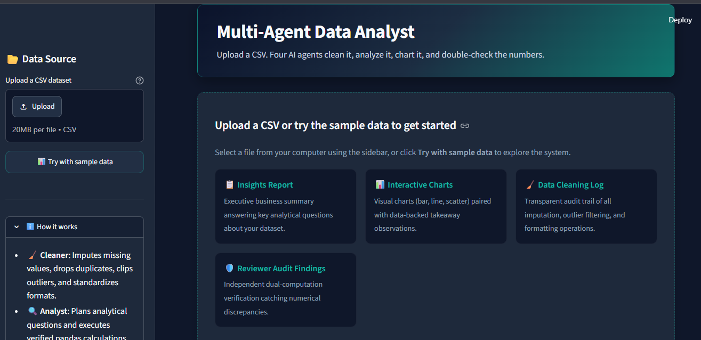
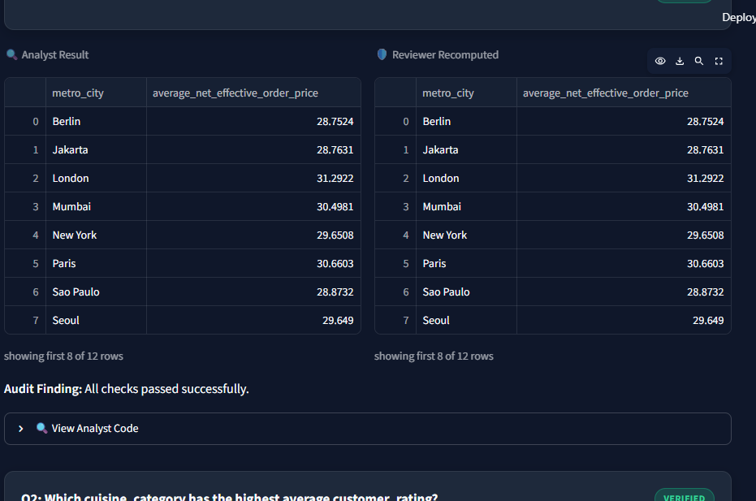

# Multi-Agent Data Analyst

I built this project to analyze tabular datasets by coordinating four specialized agents. You upload a CSV, and the agents profile and clean the data, formulate business questions, write and execute pandas code, build interactive Plotly charts, and independently recheck the computed results before producing a final report.

**Tech stack**: Python, LangGraph, pandas, Plotly, Streamlit, and Groq with `openai/gpt-oss-120b` (Google Gemini is also supported via `llm.py`).

---

## Screenshots

### Empty State
Initial interface when loading the application before uploading a dataset:



### Dataset Snapshot
Overview showing parsed columns, detected data types, row counts, and sample records:


### Reviewer Findings
Audit view showing side-by-side recomputations (Analyst Result vs Reviewer Recomputed) and verification status:



### Reviewer Retry Flow
*(The interface screenshot for the reviewer critique loop catching a discrepancy in the activity timeline is currently missing from `docs/screenshots/` and will be added in a future update).*

---

## How It Works

The workflow is orchestrated using a LangGraph `StateGraph`. The pipeline routes data sequentially through cleaning, analysis, charting, and review. If the reviewer detects an issue and the retry limit has not been reached, feedback is sent back to the analyst for correction.


### Agent Roles
- **Cleaner Agent**: Inspects the raw dataset profile, requests a JSON cleaning plan from the LLM, and applies deterministic transformations using built-in functions.
- **Analyst Agent**: Proposes analytical questions based on schema, writes pandas code to compute the answers, and runs it inside a sandboxed process.
- **Visualizer Agent**: Chooses chart types (bar, line, scatter, or summary metric card) and writes Plotly code to generate interactive visualizations.
- **Reviewer Agent**: Independently recomputes answers using alternative pandas methods, evaluates sanity invariants, and flags discrepancies.

### Design Decisions
- **LLM never executes arbitrary code on raw data during cleaning**: The cleaner asks the LLM for a structured JSON plan specifying actions (e.g. `drop_duplicates`, `strip_whitespace`, `impute_missing`) and executes them using deterministic pandas operations.
- **Sandboxed code execution**: Analyst code runs in a restricted subprocess with an AST static validator (blocking `open`, `eval`, `exec`, and forbidden imports), whitelisted built-in functions, execution timeouts (default 10 seconds), and a copy of the DataFrame to prevent accidental in-place mutation.
- **Independent recomputation**: The reviewer does not simply read the analyst's code and nod along. It writes and executes a separate pandas implementation to verify the numerical results within an allowable numerical tolerance.
- **Bounded feedback loop**: If discrepancies are found, the pipeline routes critique back to the analyst for a maximum of 3 retries.
- **Fail-fast on API outages**: If the LLM provider is down, rate-limited, or misconfigured, the application raises explicit exceptions (`LLMUnavailableError` / `LLMConfigError`) rather than silently returning an empty success report.
- **Per-model resource accounting**: Every LLM invocation records input tokens, output tokens, and latency broken down by model name in module-level usage counters.
- **Resumable and budgeted evaluation harness**: Evaluation scripts write cases incrementally to JSONL files, skip finished cases on restart, and abort cleanly when exceeding a predefined token budget.

---

## Quick Start

### 1. Environment Setup

#### Windows (PowerShell)
```powershell
python -m venv venv
.\venv\Scripts\Activate.ps1
pip install -r requirements.txt
```

#### macOS / Linux
```bash
python3 -m venv venv
source venv/bin/activate
pip install -r requirements.txt
```

### 2. Configure Environment Variables
Copy `.env.example` to `.env`:
```bash
cp .env.example .env
```

The configuration file supports the following environment variables:
- `LLM_PROVIDER`: `"groq"` (default) or `"gemini"`.
- `GROQ_API_KEY`: API key for Groq.
- `GROQ_MODEL`: Model identifier on Groq (default: `openai/gpt-oss-120b`).
- `GEMINI_API_KEY`: API key for Google Gemini.
- `GEMINI_MODEL`: Model identifier for Gemini (default: `gemini-2.0-flash`).

*Note on Groq rate limits*: Groq's free tier imposes requests-per-minute and daily token limits. A complete end-to-end pipeline run on `data/sample.csv` consumes approximately 20,000 tokens across cleaning, 3 analysis questions, visualization, review, and report synthesis.

### 3. Run the CLI Pipeline
Run the multi-agent workflow on a dataset directly from the terminal:
```bash
python run.py data/sample.csv
```

### 4. Run the Streamlit Web Application
Launch the interactive dashboard:
```bash
streamlit run app.py
```

### 5. Run the Tests
Run the entire automated test suite:
```bash
pytest -q
```

---

## Evaluation

I evaluated each component and the complete pipeline against ground-truth benchmarks on `data/sample.csv` (1,000 food delivery order records). All measurements used `openai/gpt-oss-120b` on Groq at commit `42a928c`. The raw logs and summary files are stored in `docs/eval/`.

### 1. Reviewer Component Test
I evaluated the reviewer in isolation on 20 analytical benchmark questions across 2 repeated runs (`docs/eval/reviewer_run2_after_fix_summary.md`). The evaluation used 40 synthetic wrong answers that I hand-crafted (introducing deliberate errors such as wrong filters, wrong group-by keys, inverted ranking directions, and off-by-one bounds) alongside 20 correct answers, yielding 60 unique cases (120 observations total).

| Metric | Unique Cases | Observations | Detected (Mean per Repeat) | Rate (Mean over Repeats) | 95% Wilson CI |
| :--- | :---: | :---: | :---: | :---: | :---: |
| **Detection Rate** (Sensitivity) | 40 | 80 | 39.5 | 98.8% | [89.1%, 99.9%] |
| **Detection for the Right Reason** | 40 | 80 | 37.0 | 92.5% | [80.1%, 97.4%] |
| **False Alarm Rate** (1 - Specificity) | 20 | 40 | 0.5 | 2.5% | [0.3%, 20.0%] |
| **Subtle Errors Detected** | 6 | 12 | 5.5 | 91.7% | [51.7%, 99.1%] |

*Intervals treat the 40 unique wrong cases or 20 unique correct cases as the sample size; repeats average out LLM sampling variation.*

- **Impact of bug fixes**: In the first evaluation run before bug fixes (`docs/eval/reviewer_run1_before_fix_summary.md`), the reviewer detected 39/40 wrong answers (97.5%) with 2/20 false alarms (10.0%). After fixing two comparison handling bugs, false alarms dropped to 0.5/20 (2.5%) and detection rose to 39.5/40 (98.8%).

### 2. Cleaner Agent Test
I compared the LLM cleaner against a simple 15-line deterministic pandas script across 3 random seeds (seeds 42, 43, and 44) on `data/sample.csv` with synthetic errors injected (`docs/eval/cleaner_run2_summary.md`).

| Metric | Baseline Mean | LLM Cleaner Mean |
| :--- | :---: | :---: |
| **Duplicate Removal Rate** | 100.0% | 100.0% |
| **Missing Values Handled Rate** | 0.1% | 60.0% |
| **Numbers as Text: True Value Recovery** | **99.2%** | **66.2%** |
| **Negative Values Remaining** | 40.0 | 40.0 |
| **Mean Statistical Drift** | 0.3% | 1.5% |
| **Damage (Unintended Changes)** | 0.0% | 0.0% |

- **Where the baseline beat the LLM cleaner**: The 15-line baseline outperformed the LLM cleaner on recovering numbers stored as text (99.2% vs 66.2%). The LLM cleaner executed a `convert_dtype` action that coerced strings containing currency symbols like `"$12.50"` directly into `NaN`. A subsequent median fill step then overwrote those `NaN` values with the column median ($32.50), resulting in silent data corruption. The baseline script explicitly stripped currency formatting before casting.
- **Unhandled errors**: Neither the baseline nor the LLM cleaner corrected negative values (leaving all 40 injected negative values intact) because neither had rules for domain-specific valid value ranges.
- **Harness fix**: An earlier cleaner evaluation run was invalidated and archived in `docs/eval/cleaner_run1_INVALID_harness_bug.md` because an error injection bug corrupted the primary key column (`order_id`), producing duplicate keys and misleading row-loss counts.

### 3. End-to-End System Comparison
I evaluated three system configurations across 12 benchmark questions with 2 repeated runs (`docs/eval/e2e_comparison_summary.md`):
- **System A**: Single prompt with code generation and sandbox execution (no retries, no reviewer).
- **System B**: Analyst agent with self-repair on execution errors.
- **System C**: Full pipeline with Analyst and Reviewer feedback loop.

| System | Unique Items | Accuracy Rate | 95% Wilson CI | LLM Calls | Tokens Consumed | Execution Time |
| :--- | :---: | :---: | :---: | :---: | :---: | :---: |
| **System A** (Single prompt) | 12 | 100.0% | [75.7%, 100.0%] | 24 | 10,506 | 103.9s |
| **System B** (Analyst self-repair) | 12 | 100.0% | [75.7%, 100.0%] | 24 | 11,039 | 99.0s |
| **System C** (Analyst + Reviewer) | 12 | 100.0% | [75.7%, 100.0%] | 91 | 56,859 | 338.4s |

- **Paired impact**:
  - **FIXED by reviewer**: 0 (0.0%)
  - **HARMED by reviewer**: 0 (0.0%)
  - **Both correct**: 24 of 24 observations (100.0%)
- **Reviewer overhead**: The reviewer loop added 67 LLM calls and 45,820 tokens, multiplying token consumption by **5.15x** and execution time by **3.42x** compared to System B.
- **False alarms**: The reviewer raised 2 false alarms across the 24 runs (both on Item 11 due to recomputation discrepancies on weather condition filters). In both instances, the analyst defended its original correct code and preserved the right answer.
- **Conclusion**: Because `openai/gpt-oss-120b` answered all 12 questions correctly on the first attempt across Systems A, B, and C, this specific benchmark was unable to demonstrate an accuracy improvement from the reviewer agent.

### 4. What the Evaluation Caught in My Code
Running systematic evaluations exposed five distinct bugs in my implementation:
1. **Reviewer comparison bugs**: A fallback comparator stripped series index labels, causing correct grouping calculations to be flagged as mismatches. In another case, single-cell DataFrames were treated as non-comparable to scalar floats.
2. **Evaluation harness error injection bug**: The injection script corrupted the unique primary key column (`order_id`), which broke row tracking and created misleading loss metrics in `cleaner_run1_INVALID_harness_bug.md`.
3. **Cleaner data loss**: Coercing currency strings to numeric dtypes converted `"$12.50"` to `NaN`, which was subsequently filled with the column median ($32.50) without warning.
4. **Silent API failure in UI**: When the LLM provider encountered rate limits or connection errors, the web application failed silently and displayed an empty completed report. I added explicit `LLMUnavailableError` handling to ensure fast, visible failure.
5. **Statistical pooling error**: Confidence intervals originally pooled repeated runs as independent observations, making sample sizes look twice as large as they actually were. I corrected this to compute Wilson intervals strictly over unique cases.

---

## Limitations

- **Small benchmark scope**: The benchmark consists of 20 analytical questions evaluated on a single food delivery dataset (`data/sample.csv`).
- **Synthetic error generation**: The 40 reviewer test cases were created programmatically and manually rather than mined from organic user errors.
- **Model homogeneity**: The same underlying model (`openai/gpt-oss-120b`) served as both analyst and reviewer. When a model exhibits systemic reasoning biases on specific phrasing, both agents can make the same mistake (e.g. one subtle error was missed because the reviewer adopted the analyst's wrong column).
- **Tuning overlap**: The benchmark questions were inspected during development to diagnose and fix two comparison bugs, making the measured 98.8% detection rate somewhat optimistic.
- **Easy end-to-end benchmark**: The 12-question end-to-end evaluation was too straightforward for `openai/gpt-oss-120b`, resulting in 100% accuracy across all systems and preventing measurement of reviewer error correction.
- **Reviewer recomputation errors**: In 6 out of 80 wrong-answer evaluations, the reviewer's own recomputed value was inaccurate (5 were flagged "by luck" because the wrong recompute still differed from the wrong analyst answer, and 1 subtle error was passed).
- **Row order invariance**: Table comparison logic treats DataFrames with matching row sets as equal regardless of row ordering.
- **Sandbox boundaries**: The multiprocessing execution environment with AST checking provides a basic safeguard against common accidents, but it is not a secure containerized sandbox.
- **Rate limits**: Groq's daily free-tier token allowances constrained the number of repeated runs and seeds I could evaluate.

---

## Repository Structure

```text
multi-data-analyst-agent/
├── agents/        # Cleaner, Analyst, Visualizer, and Reviewer agent implementations
├── assets/        # CSS styling rules for the Streamlit dashboard
├── components/    # Reusable UI widgets, event renderers, and state management
├── data/          # Sample CSV datasets and cleaning artifacts
├── docs/          # Evaluation summaries (docs/eval/) and UI screenshots (docs/screenshots/)
├── eval/          # Benchmark questions, error injectors, scoring engine, and eval runners
├── outputs/       # Generated markdown reports and interactive Plotly HTML charts
├── tests/         # Automated pytest suite (188 unit and integration tests)
├── tools/         # Multiprocessing code sandbox and DataFrame profiler
├── app.py         # Streamlit web application entrypoint
├── graph.py       # LangGraph StateGraph pipeline assembly and routing logic
├── llm.py         # Unified LLM provider interface (Groq, Gemini) with token tracking
├── requirements.txt # Project Python dependencies
└── run.py         # Command-line interface pipeline runner
```

---

## What I Would Do Next

- **Cleaner fixes**: Update `convert_dtype` to strip currency symbols and punctuation before numeric coercion, add warnings whenever coercion creates `NaN` values, and implement valid domain range rules to filter impossible values (e.g. negative prices).
- **Asymmetric model evaluation**: Test a smaller, faster model (e.g. an 8B parameter model) as the analyst paired with a larger model as the reviewer to measure whether the review loop improves accuracy when the initial draft contains real errors.
- **Blind reviewer**: Prevent the reviewer from viewing the analyst's code, forcing it to generate its recomputation purely from the question and schema to avoid anchoring bias.
- **Multi-dataset benchmarking**: Expand evaluations across diverse domains (e.g. retail inventory, healthcare, financial transactions) with varied schemas.

---

## Author

**Samiksha**  
GitHub: [samikshagla/multi-agent-data-analyst](https://github.com/samikshagla/multi-agent-data-analyst)
